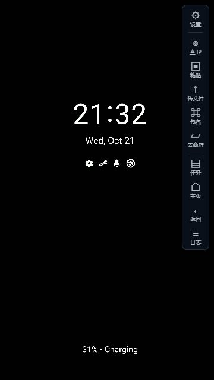

# GoScrcpy

用 Go + Wails 构建的手机投屏与控制工具，在同一个桌面界面连接 Android 和越狱 iPhone/iPad。支持独立投屏窗口、鼠标键盘操作、文件管理和手机 Shell。

**[下载 Windows 版本](https://github.com/wwangmc/GoScrcpy/releases/latest)** · **[iOS 配套插件 PhoneVideoTweak](https://github.com/wwangmc/PhoneVideoTweak)** · **[下载 iOS 插件](https://github.com/wwangmc/PhoneVideoTweak/releases/latest)**



## 功能

| 功能 | Android | 越狱 iOS |
| --- | --- | --- |
| 实时投屏 | scrcpy H.264 | PhoneVideo H.264 / JPEG 截图 |
| 鼠标操作 | 点击、拖动、滚轮、返回 | 点击、单点拖动、滚轮转滑动 |
| 键盘与文字 | 文字、剪贴板粘贴、快捷按键 | Unicode 文字、Enter/Tab、删除、左右光标 |
| 快捷控制 | 主页、任务、电源等 | Home、任务、电源 |
| 文件管理 | ADB 文件操作 | AFC2 根目录、AFC 媒体目录、应用共享文档 |
| Shell | 交互式 adb shell | 通过 USB 连接手机 OpenSSH |
| 一键地区设置 | — | 系统语言、地区和时区，共 47 个预设 |
| 查 IP、前台包名、跳转应用商店 | 支持 | — |

每台手机使用独立连接和投屏窗口，可同时操作多台设备。关闭一个投屏窗口不会影响其他设备。界面按设备能力显示功能；侧边工具栏在鼠标靠近窗口右侧时展开。

当前没有音频转发、录屏、游戏按键映射和群控。

## 下载与运行

Release 提供 `GoScrcpy.exe` 和 `GoScrcpy-<版本>-windows-amd64.zip`，面向 Windows 10/11 x64。压缩包包含程序、说明及第三方许可证；**不包含 ADB 和 Apple USB 驱动**。

1. 从 [Releases](https://github.com/wwangmc/GoScrcpy/releases/latest) 下载并解压，确认电脑已安装 WebView2 Runtime。
2. 按下方说明准备手机，用 USB 连接并允许授权。
3. 运行 `GoScrcpy.exe`，刷新列表后双击手机，打开独立投屏窗口。
4. 鼠标移到窗口右侧打开工具栏，可切换画面参数、发送文字、打开文件管理或 Shell。

### Android

- Android 5.0+，打开开发者选项和 USB 调试，允许电脑调试授权。部分机型还需开启 USB 调试的安全设置。
- 安装 Android platform-tools，将 `adb` 加入 PATH，或设置环境变量 `ADB_PATH` 指向 `adb.exe`。也可把 ADB 和配套 DLL 放到程序目录。
- 视频需要 WebView2 支持 WebCodecs H.264。剪贴板粘贴通常需要 Android 7.0+，输入前先聚焦手机输入框。

Android 服务端使用内嵌的 scrcpy 3.3.4，不需要额外运行 scrcpy 桌面程序。

### iPhone / iPad

iOS 投屏需要越狱。电脑需安装 Apple USB 驱动，并运行 Apple Mobile Device Service；手机上允许信任此电脑。

推荐配套使用 **[PhoneVideoTweak](https://github.com/wwangmc/PhoneVideoTweak)**：它在手机端提供 H.264 视频、截图、触摸/键盘、设备信息、系统地区设置及 Shell 辅助接口。到它的 [Releases](https://github.com/wwangmc/PhoneVideoTweak/releases/latest) 下载与 rootful、rootless 或 RootHide 环境匹配的 deb，安装后重启 SpringBoard，并重新打开需要输入文字的应用。

GoScrcpy 优先使用 PhoneVideoTweak 控制端口 `27185`；新服务不存在时自动回退原 [mks_tweak](https://github.com/wwangmc/mks_tweak) 的 `8081` 接口。只有旧插件的手机仍可使用。PhoneVideoTweak 0.1.0 只提供视频，独立控制需要 0.2.0+。

## iOS 投屏方式

在「设置 → 画面设置 → 投屏方式」选择自动、截图或 USB H.264。

| 方式 | 行为 |
| --- | --- |
| 自动 | 优先连接 PhoneVideo H.264 视频服务；视频端口不可用时使用截图 |
| 截图 | 使用当前控制服务提供的 JPEG，保留原始分辨率 |
| USB H.264 | 使用手机 `27184` 视频端口，可调整分辨率和码率；连接失败会报错 |

同一会话固定控制来源，接口失败不会在另一插件上重复执行命令。H.264 服务已经连接后的协议或编码错误会直接报告。日志会显示实际画面方式及控制来源。

全部 iOS 插件通信通过 USBMux，电脑不监听 `27184`、`27185` 或 `8081`，不需要手动配置 iproxy。不同手机可以使用相同的手机端口。

## 文件、Shell 与地区设置

- **文件管理**：支持目录浏览、上传下载、新建文件夹、重命名、复制/剪切/粘贴、删除及进度取消。iOS 根目录访问需要手机 AFC2 服务；不可用时可使用媒体目录或系统允许共享的应用文档。
- **Shell**：Android 使用 `adb shell`；iOS 使用手机 OpenSSH，通过 USB 连接，首次登录需确认主机指纹。SSH 密码不保存。没有 OpenSSH 时可跳转手机 Sileo/Cydia 安装页。
- **一键地区设置**：只更改系统语言、地区格式和时区；每台 iPhone 分别记住地区选择。不会读写 GPT 应用配置，也不发送运营商参数，回退 mks_tweak 时同样如此。手机异步应用设置，响应不确定时不会自动重发。

## 开发与编译

需要 Go 1.23+、Wails v2 构建环境；测试前端需要 Node.js 22+。前端使用原生 JavaScript/CSS，没有 npm 构建步骤。

在仓库根目录执行：

```powershell
# 开发 / Windows 生产构建
.\scripts\dev.ps1
.\scripts\build.ps1

# Go 测试、go vet 和前端测试
.\scripts\test.ps1

# 构建 Release 压缩包与 SHA256
.\scripts\package.ps1
```

构建程序位于 `build/bin/GoScrcpy.exe`，发布文件位于 `dist/`。构建缓存保存在 `.cache/`。GitHub Actions 也会运行测试并构建 Windows 产物。

真机测试会操作手机，请明确指定设备：

```powershell
.\scripts\test.ps1 -DeviceSerial 'Android序列号' -IOSDeviceSerial 'iOS的UDID'
.\scripts\smoke.ps1 -DeviceSerial '设备序列号' -VideoMode h264
```

## 项目结构

```text
frontend/             设备列表、投屏、文件和设置界面
internal/scrcpy/      Android 视频与控制协议
internal/phonevideo/  iOS 视频、控制和旧 MKS 回退
internal/usbmux/      Apple USB 连接
internal/phone/       iOS 文件服务
internal/iossettings/ 系统地区预设
scripts/              构建、测试与发布打包
```

## 兼容性与来源

Windows 是当前 Release 的发布平台。不同 iOS/越狱环境下的全屏采集和输入效果需真机确认；60 FPS 是请求上限，实际速度取决于设备和画面。历史测试条件见 [性能记录](docs/PERFORMANCE.md)。自动测试与 CI 编译通过不代表所有设备均已验证。

Android 使用 [scrcpy](https://github.com/Genymobile/scrcpy) 协议及 Apache-2.0 服务端；桌面使用 [Wails](https://github.com/wailsapp/wails)。iOS 文件协议移植保留在 [internal/afc/LICENSE](internal/afc/LICENSE) 中的上游 MIT 许可。配套插件的源码来源与第三方声明见 [PhoneVideoTweak](https://github.com/wwangmc/PhoneVideoTweak)。
